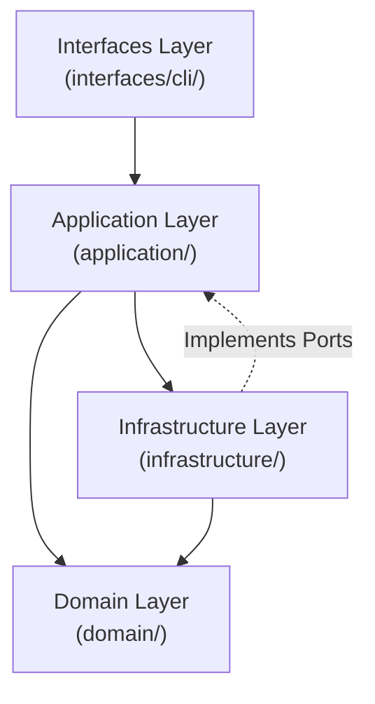
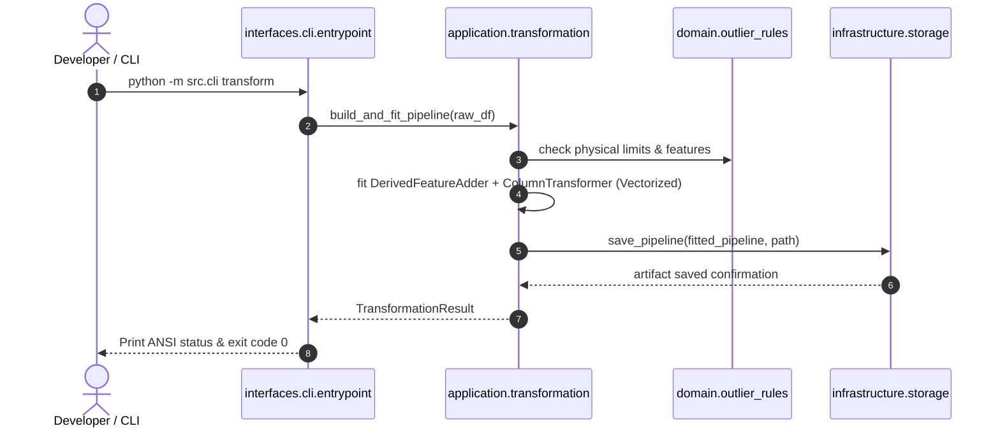

# Technical Design: Python Clean Architecture & Clean Code Refactor

- **Change ID**: `change-python-clean-architecture-refactor`
- **Domain**: `ml_service` (Data Science & ML Pipeline)
- **Status**: DESIGNED

---

## 1. Architectural Approach & Principles

The redesign shifts `ml_service/src/` from a flat, feature-grouped structure with a monolithic CLI into an idiomatic **Clean Architecture** (Ports & Adapters) design combined with high-performance **Pandas best practices**.



### Dependency Inversion Rule
Dependencies strictly point inward:
- **`domain/`**: Enterprise rules, value objects, immutable dataclasses/Pydantic schemas. Independent of all external frameworks.
- **`application/`**: Use cases (`IngestionService`, `ProfilingService`, `NullTreatmentService`, `OutlierService`, `PipelineService`). Implements vectorized operations.
- **`infrastructure/`**: Secondary adapters (filesystem paths, Joblib serializer, Markdown report renderer).
- **`interfaces/cli/`**: Primary driving adapter. Dispatches commands, parses CLI arguments, and invokes application services.

---

## 2. Code-Level Refactoring & Pandas Best Practices

### A. Anti-Pattern Elimination in Pandas

| Current Anti-Pattern | Clean Code / Vectorized Alternative | Architectural Layer |
| :--- | :--- | :--- |
| Double computation of `df[col].isna().sum()` in dict comprehension filters | `null_series = df.isna().sum()`<br/>`null_counts = null_series[null_series > 0].to_dict()` | `application/profiling.py` |
| Sequential scalar queries (`min()`, `max()`, `mean()`, etc.) in a python loop | Vectorized `agg(['min', 'max', 'mean', 'median', 'std'])` or precomputed descriptive statistics | `application/profiling.py` |
| Untyped `y=None` in Sklearn custom transformer | Explicit `y: pd.Series | np.ndarray | None = None` per PEP 484 | `application/transformation.py` |
| Manual slicing and element assignment leading to `SettingWithCopyWarning` | Explicit `.copy()` on input DataFrame and `.loc[mask, col] = val` | `application/null_treatment.py` |
| NumPy array conversion for simple quantile calculations | Native `Series.quantile([0.25, 0.75])` and vectorized `.clip()` | `application/outlier_analysis.py` |

---

## 3. Directory Structure: Clean & Screaming Architecture

```text
ml_service/src/
├── domain/                      # 1. Pure Domain Layer (No external dependencies)
│   ├── models.py                # Pydantic v2 / Frozen Entities (PEP 585/604)
│   ├── null_rules.py            # Missing value treatment contracts & policies
│   └── outlier_rules.py         # Outlier fences, physical limits & dispositions
│
├── application/                 # 2. Application Layer (Use Cases)
│   ├── ingestion.py             # Dataset verification & manifest use case
│   ├── profiling.py             # Vectorized telemetry profiling use case
│   ├── null_treatment.py        # Vectorized imputation & label validation use case
│   ├── outlier_analysis.py      # Vectorized IQR & Winsorization use case
│   ├── transformation.py        # Feature engineering & Sklearn pipeline build
│   └── features.py              # Feature name constants & column groupings
│
├── infrastructure/              # 3. Infrastructure Layer (Adapters & I/O)
│   ├── paths.py                 # Dynamic project root resolver
│   ├── storage.py               # Joblib pipeline persistence adapter
│   └── reporting.py             # Markdown profiling report generator
│
└── interfaces/                  # 4. Delivery Layer (Interfaces)
    └── cli/
        ├── entrypoint.py        # CLI parser & subcommand dispatcher
        └── commands.py          # Command action runners
```

> [!NOTE]
> `ml_service/src/cli.py` is maintained as a clean, 10-line backward-compatibility proxy delegating to `interfaces/cli/entrypoint.py`.

---

## 4. Component Interaction & Sequence Flow



---

## 5. Architectural Decisions (ADRs)

### ADR-01: Consolidation of Rules into Domain Layer
- **Context**: `null_treatment/rules.py` and `outlier_analysis/rules.py` define core industrial business rules.
- **Decision**: Relocate them to `src/domain/null_rules.py` and `src/domain/outlier_rules.py`.
- **Rationale**: Domain rules represent enterprise policies independent of execution services or CLI drivers.

### ADR-02: Vectorized Pandas Execution Policy
- **Context**: Profiling and treatment code contained repetitive loops and double-evaluations of missing values.
- **Decision**: Enforce single-pass boolean evaluations and vectorized aggregation (`.isna().sum()`, `.agg()`, `.clip()`).
- **Rationale**: Clean Code and performance optimization. Avoids unnecessary O(N*M) redundant passes.

### ADR-03: Elimination of Monolithic `cli.py`
- **Context**: `cli.py` currently violates Single Responsibility by mixing CLI argument parsing, console output rendering, error handling, and direct instantiation of all services.
- **Decision**: Break `cli.py` into `interfaces/cli/entrypoint.py` (argument definitions) and `interfaces/cli/commands.py` (command dispatchers). Maintain `src/cli.py` as a lightweight 10-line forwarder.
- **Rationale**: Clean Code and KISS. Keeps entrypoints under 50 lines and easy to test.

---

## 6. Risk Matrix & Rollback Strategy

| Risk | Impact | Probability | Mitigation |
| :--- | :---: | :---: | :--- |
| Test suite import breakage | High | Medium | Update test imports in `ml_service/tests/` atomically alongside module moves; run Pytest continuously. |
| Vectorization behavior drift | High | Low | Verify that output DataFrames match row-by-row and scalar-by-scalar against original tests. |
| Joblib unpickling regression | High | Low | Keep class name `DerivedFeatureAdder` and module path compatible with serialized models. |
| CLI breaking changes | Medium | Low | Maintain `src/cli.py` proxy to ensure existing scripts (`python -m src.cli ...`) function unchanged. |
